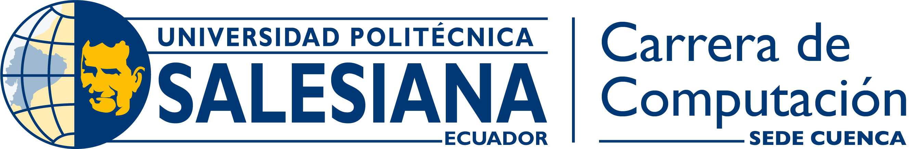

# Construcción 3D con gestos de manos



Aplicación web que permite crear y manipular cubos en un espacio 3D utilizando una cámara y gestos de las manos.

Adaptación educativa para demostraciones de la **Carrera de Computación de la Universidad Politécnica Salesiana, sede Cuenca**.

## ¿Cómo funciona?

La aplicación combina visión por computadora, inteligencia artificial y programación web:

1. El navegador accede a la cámara con autorización del usuario.
2. MediaPipe Hands analiza las imágenes y obtiene 21 puntos de referencia por mano.
3. El código JavaScript interpreta las posiciones y distancias entre esos puntos.
4. Los gestos reconocidos activan acciones sobre los objetos 3D.
5. Three.js renderiza la escena mediante WebGL.

**La inteligencia artificial localiza las manos y sus puntos; el código de la aplicación determina qué acción representa cada gesto.**

El reconocimiento se ejecuta en la computadora del usuario. En esta implementación, las imágenes de la cámara no se envían a un servidor para analizarlas.

## Funcionalidades

- Seguimiento de hasta dos manos.
- Visualización de puntos y conexiones sobre los dedos.
- Construcción de estructuras con cubos.
- Desplazamiento y rotación del conjunto.
- Eliminación de cubos mediante gestos.
- Indicadores visuales del estado y del tiempo de activación.
- Contador de cubos confirmados.
- Identidad visual institucional.

## Controles

Las referencias izquierda y derecha corresponden a las etiquetas utilizadas por la aplicación. Comprueba su correspondencia durante la demostración.

| Gesto | Acción |
|---|---|
| Mantener cerrado el puño izquierdo | Activar el agarre y desplazar el conjunto al mover la mano |
| Mantener una pinza con el pulgar y el índice derechos | Activar la construcción |
| Mover la pinza derecha después de activarla | Extender el trazo sobre un eje |
| Abrir la palma derecha | Confirmar los cubos del trazo |
| Hacer pinza con la mano izquierda y apuntar con el índice derecho | Activar el borrado en la posición señalada |
| Mantener ambas palmas abiertas | Activar la rotación del conjunto |
| Mantener ambos puños cerrados | Restablecer la posición y orientación del conjunto |

Los indicadores circulares muestran el progreso de activación de los comandos.

**Restablecer la posición y orientación no elimina los cubos.**

## Tecnologías

| Tecnología | Uso |
|---|---|
| HTML5 | Estructura de la interfaz y captura de video |
| CSS3 | Presentación visual e identidad institucional |
| JavaScript | Interpretación de gestos y lógica de interacción |
| MediaPipe Hands | Detección y seguimiento de manos |
| Three.js | Gestión de la escena y los objetos 3D |
| WebGL | Renderizado gráfico en el navegador |
| Canvas 2D | Dibujo de manos e indicadores |

MediaPipe Hands combina un modelo de detección de palmas y otro de estimación de puntos de la mano. La aplicación utiliza modelos preentrenados; no realiza entrenamiento durante su ejecución.

## Estructura del proyecto

```text
.
├── app.js
├── assets/
│   ├── logo-abet.png
│   ├── logo-sl.png
│   └── logo-ups-computacion.png
├── index.html
├── README.md
└── styles.css
```

- `index.html`: interfaz y carga de dependencias.
- `styles.css`: estilos, distribución y presentación de los logos.
- `app.js`: cámara, reconocimiento, gestos y escena 3D.
- `assets/`: recursos gráficos.

## Ejecutar localmente

### Requisitos

- Navegador actualizado con soporte para WebGL y acceso a cámara.
- Cámara integrada o externa.
- Conexión a internet para descargar las dependencias y los archivos del modelo.
- Python 3 para utilizar el servidor local de este ejemplo.

### Instalación

Clona el repositorio:

```bash
git clone https://github.com/PabloT18/Visual-Block-Coding-Studio.git
cd Visual-Block-Coding-Studio
```

Inicia el servidor:

```bash
python3 -m http.server 8000
```

Abre:

```text
http://localhost:8000/
```

Autoriza el acceso a la cámara y mantén la terminal abierta mientras utilizas la aplicación.

Para detener el servidor, pulsa `Ctrl+C`.

No requiere instalar